# SeedExpress — Complete System Documentation

> Agricultural marketplace for Algeria: plants, equipment, expert consultations, diagnosis and shipping in one platform.

**Version:** 1.0 · **Date:** 2026-11-01 · **Stack assumed:** Next.js (App Router, i18n `/en`, `/fr`, `/ar`), PostgreSQL, Prisma ORM

---

## Table of Contents

1. Vision and Scope
2. Core Concepts and Glossary
3. Account Types (Roles)
4. Onboarding and Verification
5. Permissions Matrix
6. Functional Modules
7. Business Workflows
8. Database Schema
9. Entity Relationships
10. Full ERD (Mermaid)
11. SQL / Prisma Definitions
12. Indexes, Constraints and Integrity Rules
13. API Surface
14. Algeria-Specific Rules (Wilayas, COD, Delivery)
15. Security, Privacy and Moderation
16. Notifications, Search, Analytics
17. Roadmap

---

# 1. Vision and Scope

## 1.1 What SeedExpress is

SeedExpress is a single account, multi-profile marketplace. One login connects four kinds of activity:

1. **Marketplace shopping**: plants, seeds, soil, tools, irrigation, greenhouses, farm equipment.
2. **Expert consultations**: people request advice on a land, crop, or sick plant from agronomists and plant advisers.
3. **Farm planning**: growers manage plots, crops, and seasons.
4. **Supply**: equipment merchants, manufacturers and nurseries publish and ship products.

## 1.2 Problems solved

| Problem | SeedExpress answer |
|---|---|
| Buyers cannot find trusted plant and equipment sellers | Reviewed merchant listings, ratings |
| Farmers lack access to agronomists | Consultation requests routed to verified experts |
| Plant diseases are hard to identify | Diagnosis requests with photos and expert replies |
| Delivery across 58 wilayas is complex | Shipping module with zones, carriers, tracking |
| Cash culture | Cash on delivery plus online payment options |

## 1.3 Scope boundaries

In scope: accounts, catalog, cart, orders, shipping, consultations, diagnoses, reviews, messaging, disputes, admin moderation.
Out of scope (v1): live video calls, in-house carrier fleet, cross-border export, crop-yield prediction AI.

## 1.4 Design principles

- **One identity, many roles**: a user can hold several roles (for example a farmer who is also a regular buyer).
- **Review before publish**: experts and merchants are inactive for publishing until approved.
- **Everything auditable**: status histories on orders, consultations, shipments.
- **Algeria first**: wilaya/commune addressing, DZD currency, Arabic RTL, French and English.

---

# 2. Core Concepts and Glossary

| Term | Meaning |
|---|---|
| User | A login identity (email/phone + password) |
| Account type | The profile the user chose at sign-up |
| Role | A permission bundle attached to a user |
| Merchant | Equipment merchant / supplier account holder |
| Expert | Agricultural expert account holder |
| Farmer | Farmer / grower account holder |
| Member | Regular member account holder |
| Listing / Product | An item for sale |
| Plant | A product subtype with horticultural data |
| Consultation | A paid or free expert service request |
| Diagnosis | A plant-health request, usually photo-based |
| Plot | A parcel of land managed by a farmer |
| Shipment | Physical delivery tied to an order (or sub-order) |
| Sub-order | The slice of an order belonging to one seller |

---

# 3. Account Types (Roles)

The sign-up screen presents four account types, selected with a radio button, plus acceptance of the Terms and Service Agreement. Each type maps to a role and a profile table.

| # | Sign-up label | Role code | Profile table | Review required |
|---|---|---|---|---|
| 1 | Farmer / grower account | `FARMER` | `farmer_profiles` | No |
| 2 | Regular member account | `MEMBER` | `member_profiles` | No |
| 3 | Agricultural expert account | `EXPERT` | `expert_profiles` | Yes (credentials) |
| 4 | Equipment merchant / supplier account | `MERCHANT` | `merchant_profiles` | Yes (business documents) |
| – | Platform staff | `ADMIN`, `MODERATOR`, `SUPPORT` | `staff_profiles` | Internal |

## 3.1 Farmer / Grower Account (`FARMER`)

**Who:** people who manage crops, a farm plot, a greenhouse, or a productive garden.

**Goals:** buy plants and equipment, get expert help, plan seasons, track plots.

**Can do:**
- Browse and buy from the marketplace
- Create and manage **plots** (land parcels with area, soil type, irrigation, location)
- Track **crop cycles** per plot (planting, expected harvest)
- Request **expert consultations** linked to a plot
- Submit **plant diagnosis** requests with photos
- Save products, follow guides, write reviews
- Manage addresses and orders, request returns

**Cannot do:** publish listings, answer consultations, access admin tools.

**Profile data:** farm name, farm size (hectares), main crops, farming type (open field, greenhouse, orchard, hydroponic), wilaya, years of experience.

**Typical journey:** sign up → add plot → request consultation for irrigation → expert replies with plan → farmer orders recommended drip kit → shipment delivered → farmer reviews merchant and expert.

## 3.2 Regular Member Account (`MEMBER`)

**Who:** home growers and balcony gardeners.

**Goals:** shop for small quantities, save products, learn through guides.

**Can do:**
- Browse, search, filter, save products (wishlist)
- Order, pay, track shipments
- Follow guides and articles
- Request diagnosis (free tier limited) and consultations
- Write reviews on purchased products

**Cannot do:** manage plots (optional upgrade), publish listings, answer requests.

**Profile data:** display name, gardening interest, space type (balcony, backyard, indoor), wilaya.

**Upgrade path:** a member can add the `FARMER` role later without creating a new account.

## 3.3 Agricultural Expert Account (`EXPERT`)

**Who:** agronomists, irrigation specialists, plant pathologists, nursery advisers.

**Goals:** offer consultations across Algeria, answer diagnosis requests, earn fees, build reputation.

**Can do (after approval):**
- Publish an expert profile with specialties, regions served, languages, fees
- Define consultation services (on-site visit, remote chat, farm audit, irrigation design)
- Accept or decline consultation requests
- Answer diagnoses and attach recommendations (including product links)
- Publish guides and articles
- Manage availability calendar
- View earnings and payouts

**Verification:** diploma or certificate, national ID, professional registration, optional references.

**Status lifecycle:** `PENDING` → `APPROVED` | `REJECTED` | `SUSPENDED`.
Until approved, the expert can edit the profile but cannot appear in search or receive requests.

## 3.4 Equipment Merchant / Supplier Account (`MERCHANT`)

**Who:** companies selling irrigation, tools, soil, greenhouses, farm equipment, seeds and nurseries (plants).

**Goals:** list products, receive orders, ship across Algeria, manage stock and payouts.

**Can do (after approval):**
- Create a **store** with branding, policies, shipping zones
- Publish products and plants, manage variants and stock
- Receive sub-orders, confirm, pack, hand to carrier, update tracking
- Handle returns and disputes
- View sales reports, payouts, commissions
- Reply to reviews and product questions

**Verification:** commercial register number (RC), tax ID (NIF), business address, bank/CCP details, owner ID.

**Listing review:** the sign-up text states that listings are reviewed before they go live. Statuses: `DRAFT` → `PENDING_REVIEW` → `PUBLISHED` | `REJECTED`. After a trusted-merchant threshold, moderators may enable auto-publish.

## 3.5 Staff Roles

| Role | Purpose |
|---|---|
| `ADMIN` | Full control, configuration, financials |
| `MODERATOR` | Approves experts, merchants, listings, reviews, resolves reports |
| `SUPPORT` | Helps users, handles disputes and order issues |

## 3.6 Multi-role Users

A user can hold several roles at once. Example: a farmer who also becomes an expert. Rules:
- One `users` row, many `user_roles` rows
- Each role has its own profile table row
- The UI exposes a role switcher in the account menu
- Permissions are the union of active roles, but actions are context-bound (for example, a user cannot review their own store)
- Self-dealing is blocked: a merchant cannot buy from their own store, an expert cannot review their own consultation

---

# 4. Onboarding and Verification

## 4.1 Sign-up flow

1. Open `/en/sign-up`
2. Read the intro: one account connects marketplace shopping, consultations and farm planning
3. Choose account type (four radio cards)
4. Accept the **Terms & Conditions** and **Service Agreement** (checkbox required)
5. Enter identity: full name, email or phone, password
6. Verify email or phone (OTP)
7. Complete role-specific profile
8. For expert and merchant: submit documents → status `PENDING`

Stored consent: `user_agreements` records document version, timestamp, IP, and locale.

## 4.2 Role-specific onboarding forms

**Farmer:** farm name, wilaya, commune, farm size, farming type, main crops, first plot (optional).
**Member:** wilaya, interests, space type.
**Expert:** specialties, years of experience, wilayas served, languages, bio, fee model, documents.
**Merchant:** store name, legal name, RC, NIF, categories sold, warehouse address, shipping preferences, payout account, documents.

## 4.3 Verification workflow

```
Submit documents
   -> status PENDING
   -> moderator queue
   -> approve / request changes / reject
   -> user notified
   -> if approved: role capabilities unlocked
```

Each decision is stored in `verification_reviews` with reviewer, decision, reason, timestamp.

## 4.4 Suspension and reinstatement

Triggers: repeated policy violations, fraud, unresolved disputes, expired documents.
Effects: listings hidden, new orders blocked, pending payouts held.
Reinstatement requires a moderator decision and a recorded reason.

---

# 5. Permissions Matrix

Legend: ✅ allowed · ⛔ not allowed · 🔒 allowed after approval · 👁 own data only

| Capability | MEMBER | FARMER | EXPERT | MERCHANT | MODERATOR | ADMIN |
|---|---|---|---|---|---|---|
| Browse catalog | ✅ | ✅ | ✅ | ✅ | ✅ | ✅ |
| Add to cart / order | ✅ | ✅ | ✅ | ✅ (not own) | ✅ | ✅ |
| Wishlist | ✅ | ✅ | ✅ | ✅ | ✅ | ✅ |
| Manage plots | ⛔ | ✅ | ⛔ | ⛔ | 👁 | ✅ |
| Request consultation | ✅ | ✅ | ✅ | ✅ | ⛔ | ⛔ |
| Request diagnosis | ✅ | ✅ | ✅ | ✅ | ⛔ | ⛔ |
| Answer consultation | ⛔ | ⛔ | 🔒 | ⛔ | ⛔ | ⛔ |
| Answer diagnosis | ⛔ | ⛔ | 🔒 | ⛔ | ⛔ | ⛔ |
| Publish products | ⛔ | ⛔ | ⛔ | 🔒 | ✅ | ✅ |
| Manage store orders | ⛔ | ⛔ | ⛔ | 🔒 | ✅ | ✅ |
| Publish guides | ⛔ | ⛔ | 🔒 | 🔒 | ✅ | ✅ |
| Write reviews | ✅ (verified) | ✅ (verified) | ✅ (verified) | ✅ (verified) | ⛔ | ⛔ |
| Moderate reviews | ⛔ | ⛔ | ⛔ | reply only | ✅ | ✅ |
| Approve experts/merchants | ⛔ | ⛔ | ⛔ | ⛔ | ✅ | ✅ |
| Manage commissions | ⛔ | ⛔ | ⛔ | ⛔ | ⛔ | ✅ |
| View payouts | ⛔ | ⛔ | 👁 | 👁 | ⛔ | ✅ |
| Handle disputes | ⛔ | ⛔ | ⛔ | party | ✅ | ✅ |

## 5.1 Implementation: RBAC with scopes

- `roles` (code, name)
- `permissions` (code, description)
- `role_permissions` (role_id, permission_id)
- Checks combine **role permission** + **ownership** (for example `store.owner_id = user.id`) + **status** (for example `merchant.status = APPROVED`).


---

# 6. Functional Modules

## 6.1 Identity and Access
Registration, login (email/phone), OTP, password reset, sessions, role switcher, agreements, KYC documents.

## 6.2 Catalog
- **Categories** (tree): Plants, Seeds, Soil and Fertilizers, Irrigation, Tools, Greenhouses, Farm Equipment, Pest Control
- **Products** with variants (size, pot, capacity, voltage)
- **Plant details**: botanical name, family, light, water needs, climate zone, season, growth time, edible, indoor/outdoor
- **Equipment details**: brand, model, warranty, power, dimensions, spare parts availability
- **Media**: images, videos, manuals (PDF)
- **Attributes** (flexible): key/value per product
- **Review before publish** by moderators

## 6.3 Stores (Merchants)
Store page, banner, description, policies (returns, warranty), shipping zones, working days, rating, verified badge.

## 6.4 Cart and Checkout
Multi-seller cart. At checkout the cart splits into **sub-orders**, one per store, each with its own shipping and status. Payment methods: cash on delivery (COD), bank card (CIB/Edahabia via gateway), bank transfer/CCP, wallet.

## 6.5 Orders and Fulfilment
Parent `orders` row for the customer, child `order_items` grouped by `sub_orders`. Seller confirms, packs, ships. Status history is stored.

## 6.6 Shipping
Wilaya-based zones, carrier integration (Yalidine, ZR Express, Procolis, Noest or similar), home delivery or stop-desk pickup, weight and volume rules, tracking events, failed-delivery handling, COD cash remittance.

## 6.7 Expert Consultations
Expert services, request, quote, scheduling, chat thread, report, payment, review.

## 6.8 Plant Diagnosis
Photo upload, symptoms, plant type, location; expert replies with diagnosis, treatment plan, recommended products (linked to the catalog) and follow-up.

## 6.9 Farm Planning
Plots, crop cycles, tasks (irrigate, fertilize, spray), reminders, seasonal calendar, harvest log.

## 6.10 Content
Guides, articles, videos by experts and staff; tags; saved guides.

## 6.11 Reviews and Ratings
Verified-purchase product reviews, store reviews, expert reviews. Moderation, helpful votes, seller replies.

## 6.12 Messaging
Buyer-seller product questions, expert-client threads, support tickets. Attachments allowed.

## 6.13 Payments and Payouts
Payments, refunds, commission, seller balances, payout requests, expert earnings, ledger entries.

## 6.14 Disputes and Returns
Return requests with reasons and evidence, dispute escalation to support.

## 6.15 Administration
Verification queue, listing review queue, report handling, commissions, settings, audit logs, analytics.

## 6.16 Notifications
In-app, email, SMS, push; per-event preferences.

---

# 7. Business Workflows

## 7.1 Purchase flow (member or farmer)

```
Browse -> Product page -> Add to cart -> Checkout
  -> choose address (wilaya/commune)
  -> choose delivery (home / stop-desk)
  -> choose payment (COD / card / CCP)
  -> Place order
  -> System splits into sub-orders per store
  -> Each store: CONFIRMED -> PACKED -> HANDED_TO_CARRIER
  -> Shipment: IN_TRANSIT -> OUT_FOR_DELIVERY -> DELIVERED
  -> Buyer review unlocked
```

### Order status machine (sub-order)

| From | To | Actor |
|---|---|---|
| `PENDING` | `CONFIRMED` | Merchant |
| `PENDING` | `CANCELLED` | Buyer or merchant |
| `CONFIRMED` | `PACKED` | Merchant |
| `PACKED` | `SHIPPED` | Merchant / carrier |
| `SHIPPED` | `DELIVERED` | Carrier / system |
| `SHIPPED` | `DELIVERY_FAILED` | Carrier |
| `DELIVERED` | `RETURN_REQUESTED` | Buyer (within window) |
| `RETURN_REQUESTED` | `RETURNED` / `RETURN_REJECTED` | Merchant / support |

Live plants have a **short return window** (for example 48 hours, only if dead on arrival with photos). Equipment follows the standard window.

## 7.2 Merchant onboarding and listing

```
Sign up as MERCHANT -> submit documents -> PENDING
 -> moderator approves -> store created
 -> merchant adds product (DRAFT) -> submits -> PENDING_REVIEW
 -> moderator publishes -> visible in catalog
```

## 7.3 Expert consultation flow

```
Client opens expert profile -> picks service
 -> creates consultation request (optional plot, photos, description, preferred dates)
 -> expert: ACCEPT / DECLINE / PROPOSE_QUOTE
 -> client accepts quote -> payment held (escrow)
 -> session happens (chat / call / on-site visit)
 -> expert submits report + recommendations
 -> client confirms -> payment released (minus commission)
 -> client reviews expert
```

### Consultation status machine

`REQUESTED` → `ACCEPTED` | `DECLINED` → `QUOTED` → `PAID` → `SCHEDULED` → `IN_PROGRESS` → `COMPLETED` → `CLOSED`; side exits: `CANCELLED`, `DISPUTED`.

Types: `REMOTE_CHAT`, `PHONE_CALL`, `ON_SITE_VISIT`, `FARM_AUDIT`, `IRRIGATION_DESIGN`, `SOIL_ANALYSIS_REVIEW`.

## 7.4 Plant diagnosis flow

```
User uploads photos + symptoms -> DIAGNOSIS_REQUESTED
 -> routed to matching experts (specialty, wilaya, language)
 -> expert claims -> IN_REVIEW
 -> expert posts: probable cause, severity, treatment plan, recommended products
 -> user marks helpful / asks follow-up
 -> CLOSED
```

Recommended products are stored as `diagnosis_recommendations` linking to `products`, enabling one-click add to cart. This links **experts → catalog → merchants**, the core value loop.

## 7.5 Farm planning flow

Farmer creates a **plot** → adds a **crop cycle** (crop, variety, sowing date, expected harvest) → generates **tasks** → reminders → logs harvest. Expert reports can attach to a plot and spawn tasks.

## 7.6 Shipping flow

1. Merchant marks sub-order `PACKED`
2. System selects carrier by zone and weight; creates shipment, stores tracking number and label
3. Carrier webhooks create `shipment_events`
4. On `DELIVERED`, sub-order becomes `DELIVERED`; COD amount is recorded as collected
5. Carrier remits COD; system credits merchant balance minus commission and shipping fee
6. On failed delivery: retry (max 2), then return to sender

## 7.7 Payment and payout flow

- Online: gateway payment → `payments(status=PAID)` → funds held until delivery
- COD: payment created `PENDING_COD` → `PAID` when carrier confirms collection
- Commission is computed per sub-order item category
- Ledger entries record every movement (double-entry style): buyer payment, commission, shipping fee, refund, payout
- Merchants and experts request payouts; admin approves; `payouts` rows track transfers

## 7.8 Returns and disputes

Buyer opens return → merchant responds → if disagreement → dispute escalates to support → decision (refund full/partial, replace, reject) → ledger adjusted.

## 7.9 Review flow

Unlocked after delivery (products/stores) or consultation completion (experts). One review per purchased item or consultation. Moderators can hide abusive reviews. Sellers may reply once.

---

# 14. Algeria-Specific Rules

## 14.1 Geography
58 wilayas, then communes (daira optional). Addresses store `wilaya_id` and `commune_id`. Shipping prices are computed by origin wilaya → destination wilaya zone.

## 14.2 Currency and tax
Currency `DZD`. Prices stored as integers in centimes or as `NUMERIC(12,2)`. VAT (TVA) rate stored per category when applicable.

## 14.3 Payments
- COD dominant; require phone confirmation for large COD orders
- CIB / Edahabia (via a local payment gateway such as SATIM-based providers)
- CCP / bank transfer with proof upload and manual verification

## 14.4 Merchant legal data
RC (registre de commerce), NIF, NIS, AI (article d'imposition) where applicable.

## 14.5 Languages
Arabic (RTL), French, English. Translatable fields use `*_translations` tables or JSONB `name_i18n`.

## 14.6 Phytosanitary constraints
Some plants, seeds and agrochemicals may be regulated. Product has `requires_license` and moderators check compliance before publishing.


---

# 8. Database Schema

Conventions: `id` is UUID primary key; `created_at`, `updated_at` on all tables; soft delete via `deleted_at` where noted; money as `NUMERIC(12,2)` in DZD; enums are PostgreSQL enums.

## 8.1 Table groups

| Group | Tables |
|---|---|
| Identity | `users`, `roles`, `permissions`, `role_permissions`, `user_roles`, `sessions`, `user_agreements`, `otp_codes` |
| Profiles | `member_profiles`, `farmer_profiles`, `expert_profiles`, `merchant_profiles`, `staff_profiles` |
| Verification | `verification_documents`, `verification_reviews` |
| Geography | `wilayas`, `communes`, `addresses` |
| Stores | `stores`, `store_shipping_zones`, `store_policies` |
| Catalog | `categories`, `products`, `product_variants`, `plant_details`, `equipment_details`, `product_media`, `product_attributes`, `brands`, `tags`, `product_tags` |
| Inventory | `inventory_items`, `stock_movements` |
| Shopping | `carts`, `cart_items`, `wishlists`, `wishlist_items` |
| Orders | `orders`, `sub_orders`, `order_items`, `order_status_history` |
| Shipping | `carriers`, `shipping_rates`, `shipments`, `shipment_events` |
| Payments | `payments`, `refunds`, `ledger_entries`, `payouts`, `commission_rules` |
| Experts | `expert_specialties`, `expert_regions`, `expert_services`, `expert_availability` |
| Consultations | `consultations`, `consultation_quotes`, `consultation_reports`, `consultation_status_history` |
| Diagnosis | `diagnosis_requests`, `diagnosis_media`, `diagnosis_responses`, `diagnosis_recommendations` |
| Farm planning | `plots`, `crop_cycles`, `farm_tasks`, `harvest_logs` |
| Content | `guides`, `guide_tags`, `saved_guides` |
| Social | `reviews`, `review_votes`, `review_replies` |
| Messaging | `conversations`, `conversation_participants`, `messages`, `message_attachments` |
| Disputes | `return_requests`, `disputes`, `dispute_messages` |
| Platform | `notifications`, `notification_preferences`, `reports`, `audit_logs`, `settings` |

## 8.2 Identity tables

### users
| Column | Type | Notes |
|---|---|---|
| id | uuid PK | |
| email | citext unique null | |
| phone | varchar(20) unique null | Algerian format +213 |
| password_hash | text | |
| full_name | varchar(150) | |
| avatar_url | text null | |
| locale | enum(`ar`,`fr`,`en`) | default `fr` |
| status | enum(`ACTIVE`,`PENDING_VERIFICATION`,`SUSPENDED`,`DELETED`) | |
| email_verified_at, phone_verified_at | timestamptz null | |
| last_login_at | timestamptz null | |

### roles / user_roles
- `roles(id, code unique, name)` with codes `MEMBER, FARMER, EXPERT, MERCHANT, MODERATOR, SUPPORT, ADMIN`
- `user_roles(id, user_id FK, role_id FK, status enum(PENDING,ACTIVE,REJECTED,SUSPENDED), granted_at, granted_by FK users null)`; **unique(user_id, role_id)**

### permissions / role_permissions
Standard many-to-many between roles and permission codes such as `product.publish`, `consultation.answer`.

### user_agreements
`user_id FK, document_type (TERMS, SERVICE_AGREEMENT, MARKETPLACE_AGREEMENT), version, accepted_at, ip_address, locale`

### sessions, otp_codes
Session tokens, device info, expiry; OTP for email/phone verification with purpose and expiry.

## 8.3 Profile tables (one per account type)

### member_profiles
`user_id PK/FK unique, display_name, interests text[], space_type enum(BALCONY, BACKYARD, INDOOR, ROOFTOP), wilaya_id FK`

### farmer_profiles
`user_id PK/FK unique, farm_name, farm_size_ha numeric(10,2), farming_type enum(OPEN_FIELD, GREENHOUSE, ORCHARD, HYDROPONIC, MIXED), main_crops text[], years_experience int, wilaya_id FK, commune_id FK`

### expert_profiles
| Column | Type | Notes |
|---|---|---|
| user_id | uuid PK/FK | one-to-one with users |
| headline | varchar(160) | |
| bio | text | |
| years_experience | int | |
| languages | text[] | |
| consultation_fee_min | numeric | optional |
| verification_status | enum(PENDING, APPROVED, REJECTED, SUSPENDED) | gating |
| rating_avg, rating_count | numeric, int | denormalized |
| is_accepting_requests | boolean | |
| approved_at | timestamptz null | |

### merchant_profiles
| Column | Type | Notes |
|---|---|---|
| user_id | uuid PK/FK | owner |
| legal_name | varchar(200) | |
| commercial_register_no (RC) | varchar | unique |
| tax_id (NIF) | varchar | unique |
| nis, article_imposition | varchar null | |
| merchant_type | enum(RETAILER, MANUFACTURER, DISTRIBUTOR, NURSERY) | |
| verification_status | enum(PENDING, APPROVED, REJECTED, SUSPENDED) | |
| payout_method | enum(BANK, CCP) | |
| payout_account_ref | text | encrypted |
| auto_publish | boolean | default false |

### staff_profiles
`user_id PK/FK, department, employee_code`

## 8.4 Verification

### verification_documents
`id, user_id FK, role_id FK, doc_type enum(NATIONAL_ID, DIPLOMA, CERTIFICATE, COMMERCIAL_REGISTER, TAX_CARD, BANK_PROOF, OTHER), file_url, status enum(PENDING, VERIFIED, REJECTED), expires_at null`

### verification_reviews
`id, user_role_id FK, reviewer_id FK users, decision enum(APPROVED, CHANGES_REQUESTED, REJECTED), reason text, decided_at`

## 8.5 Geography

- `wilayas(id int PK 1..58, code, name_ar, name_fr, name_en)`
- `communes(id, wilaya_id FK, name_ar, name_fr, postal_code)`
- `addresses(id, user_id FK, label, recipient_name, phone, wilaya_id FK, commune_id FK, street, details, lat, lng, is_default)`

## 8.6 Stores

### stores
`id, owner_id FK merchant_profiles.user_id, slug unique, name, description, logo_url, banner_url, origin_wilaya_id FK, status enum(DRAFT, ACTIVE, SUSPENDED), rating_avg, rating_count, return_window_days, handling_time_hours`

### store_shipping_zones
`id, store_id FK, wilaya_id FK, home_delivery_enabled, stopdesk_enabled, min_order_amount null, free_shipping_threshold null`

## 8.7 Catalog

### categories
`id, parent_id FK self null, slug unique, name_ar, name_fr, name_en, type enum(PLANT, SEED, SOIL, IRRIGATION, TOOL, GREENHOUSE, MACHINERY, OTHER), requires_license boolean, vat_rate numeric`

### products
| Column | Type | Notes |
|---|---|---|
| id | uuid PK | |
| store_id | FK stores | seller |
| category_id | FK categories | |
| brand_id | FK brands null | |
| kind | enum(PLANT, EQUIPMENT, CONSUMABLE, SEED) | |
| title / description (i18n) | text/jsonb | |
| base_price | numeric(12,2) | |
| compare_at_price | numeric null | |
| status | enum(DRAFT, PENDING_REVIEW, PUBLISHED, REJECTED, ARCHIVED) | |
| rejection_reason | text null | |
| rating_avg, rating_count, sold_count | denormalized | |
| weight_kg, volume_cm3 | numeric | for shipping |
| is_fragile, is_live_plant | boolean | live plants need special handling |
| published_at | timestamptz null | |

### product_variants
`id, product_id FK, sku unique, name, price, attributes jsonb (size, pot, power), weight_kg, is_default`

### plant_details (1:1 with products where kind = PLANT or SEED)
`product_id PK/FK, botanical_name, family, light enum(FULL_SUN, PARTIAL, SHADE), water_need enum(LOW, MEDIUM, HIGH), climate_zones text[], planting_season text[], days_to_maturity, is_edible, is_indoor, care_guide text`

### equipment_details (1:1 with products where kind = EQUIPMENT)
`product_id PK/FK, model, warranty_months, power_spec, dimensions, manual_url, spare_parts_available`

### product_media, product_attributes, brands, tags, product_tags
Images/videos/manuals, free attributes, brand directory, tagging (M:N).

## 8.8 Inventory

- `inventory_items(id, variant_id FK unique, quantity_on_hand, quantity_reserved, low_stock_threshold)`
- `stock_movements(id, inventory_item_id FK, delta int, reason enum(SALE, RESTOCK, ADJUSTMENT, RETURN, RESERVATION, RELEASE), reference_id, created_by)`

## 8.9 Cart and wishlist

- `carts(id, user_id FK unique null, session_key)`
- `cart_items(id, cart_id FK, variant_id FK, quantity)` unique(cart_id, variant_id)
- `wishlists(id, user_id FK)`, `wishlist_items(id, wishlist_id FK, product_id FK)` unique pair

## 8.10 Orders

### orders (customer-level)
`id, order_number unique, buyer_id FK users, shipping_address_snapshot jsonb, subtotal, shipping_total, discount_total, grand_total, payment_method enum(COD, CARD, TRANSFER, WALLET), payment_status, placed_at`

### sub_orders (one per store)
`id, order_id FK, store_id FK, status enum(PENDING, CONFIRMED, PACKED, SHIPPED, DELIVERED, DELIVERY_FAILED, CANCELLED, RETURN_REQUESTED, RETURNED), subtotal, shipping_fee, commission_amount, seller_net, delivery_type enum(HOME, STOPDESK)`

### order_items
`id, sub_order_id FK, product_id FK, variant_id FK, title_snapshot, unit_price, quantity, line_total`

### order_status_history
`id, sub_order_id FK, from_status, to_status, actor_id, note, created_at`

## 8.11 Shipping

- `carriers(id, code, name, api_config jsonb, is_active)`
- `shipping_rates(id, carrier_id FK, origin_wilaya_id, dest_wilaya_id, delivery_type, base_fee, per_kg_fee, max_weight_kg, eta_days)`
- `shipments(id, sub_order_id FK unique, carrier_id FK, tracking_number, label_url, cod_amount, cod_collected_at, cod_remitted_at, status enum(CREATED, PICKED_UP, IN_TRANSIT, AT_DESK, OUT_FOR_DELIVERY, DELIVERED, FAILED, RETURNING, RETURNED))`
- `shipment_events(id, shipment_id FK, status, location, occurred_at, raw_payload jsonb)`

## 8.12 Payments and finance

- `payments(id, order_id FK, method, amount, status enum(PENDING, PENDING_COD, PAID, FAILED, REFUNDED), gateway_ref, proof_url null, paid_at)`
- `refunds(id, payment_id FK, sub_order_id FK null, amount, reason, status)`
- `commission_rules(id, category_id FK null, role enum(MERCHANT, EXPERT), percent, fixed_fee, valid_from, valid_to)`
- `ledger_entries(id, account_type enum(PLATFORM, MERCHANT, EXPERT, BUYER), account_user_id FK null, entry_type enum(SALE, COMMISSION, SHIPPING_FEE, REFUND, PAYOUT, ADJUSTMENT, CONSULTATION_FEE), amount signed numeric, ref_type, ref_id, created_at)`
- `payouts(id, user_id FK, amount, status enum(REQUESTED, APPROVED, PAID, REJECTED), method, requested_at, paid_at)`

## 8.13 Expert domain

- `expert_specialties(id, expert_id FK, specialty enum(IRRIGATION, SOIL, PLANT_PATHOLOGY, GREENHOUSE, ORCHARDS, CEREALS, VEGETABLES, ORNAMENTALS, PEST_CONTROL, HYDROPONICS, OTHER))`
- `expert_regions(id, expert_id FK, wilaya_id FK, offers_on_site boolean)`
- `expert_services(id, expert_id FK, type enum(consultation types), title, description, price, duration_minutes, is_active)`
- `expert_availability(id, expert_id FK, weekday, start_time, end_time)`

## 8.14 Consultations

### consultations
`id, client_id FK users, expert_id FK expert_profiles, service_id FK, plot_id FK null, subject, description, preferred_dates jsonb, status enum(REQUESTED, ACCEPTED, DECLINED, QUOTED, PAID, SCHEDULED, IN_PROGRESS, COMPLETED, CLOSED, CANCELLED, DISPUTED), scheduled_at, price, commission_amount, payment_id FK null`

### consultation_quotes
`id, consultation_id FK, amount, notes, valid_until, status`

### consultation_reports
`id, consultation_id FK unique, summary, findings text, recommendations text, attachments jsonb, created_at`

### consultation_status_history
Same pattern as order history.

## 8.15 Diagnosis

- `diagnosis_requests(id, requester_id FK, plot_id FK null, plant_name, symptoms text, location_wilaya_id, urgency enum(LOW, MEDIUM, HIGH), status enum(OPEN, CLAIMED, IN_REVIEW, ANSWERED, CLOSED), claimed_by FK expert null)`
- `diagnosis_media(id, request_id FK, file_url, caption)`
- `diagnosis_responses(id, request_id FK, expert_id FK, probable_cause, severity, treatment_plan, follow_up_days)`
- `diagnosis_recommendations(id, response_id FK, product_id FK, note)`  ← bridges experts to catalog

## 8.16 Farm planning

- `plots(id, farmer_id FK, name, area_ha, soil_type, irrigation_type enum(DRIP, SPRINKLER, FLOOD, RAINFED, NONE), wilaya_id, commune_id, lat, lng, polygon geojson null)`
- `crop_cycles(id, plot_id FK, crop_name, variety, sowing_date, expected_harvest_date, status enum(PLANNED, GROWING, HARVESTED, FAILED), source_product_id FK null)`
- `farm_tasks(id, crop_cycle_id FK, plot_id FK, title, type enum(IRRIGATE, FERTILIZE, SPRAY, PRUNE, HARVEST, OTHER), due_date, done_at, created_from enum(USER, EXPERT_REPORT, SYSTEM), source_ref_id)`
- `harvest_logs(id, crop_cycle_id FK, quantity, unit, harvested_at, notes)`

## 8.17 Content, social, messaging, disputes, platform

- `guides(id, author_id FK, title, body, language, status, published_at)`; `guide_tags`; `saved_guides(user_id, guide_id)`
- `reviews(id, author_id FK, target_type enum(PRODUCT, STORE, EXPERT), target_id, order_item_id FK null, consultation_id FK null, rating 1-5, title, body, status enum(VISIBLE, HIDDEN, PENDING))`; `review_votes`; `review_replies(id, review_id FK unique, author_id, body)`
- `conversations(id, type enum(PRODUCT_QUESTION, CONSULTATION, SUPPORT, ORDER), context_ref_id)`; `conversation_participants`; `messages(id, conversation_id FK, sender_id FK, body, sent_at, read_at)`; `message_attachments`
- `return_requests(id, sub_order_id FK, order_item_id FK, reason, evidence jsonb, status)`; `disputes(id, opened_by FK, against FK, ref_type, ref_id, status, resolution)`; `dispute_messages`
- `notifications(id, user_id FK, type, payload jsonb, channel, read_at)`; `notification_preferences`; `reports(id, reporter_id, target_type, target_id, reason, status)`; `audit_logs(id, actor_id, action, entity_type, entity_id, diff jsonb, ip, created_at)`; `settings(key PK, value jsonb)`

---

# 9. Entity Relationships

## 9.1 Cardinality summary

| Relationship | Type | Notes |
|---|---|---|
| users ↔ roles | M:N via `user_roles` | multi-role |
| users → member/farmer/expert/merchant profile | 1:1 each | optional per role |
| merchant_profiles → stores | 1:N (v1 usually 1:1) | |
| stores → products | 1:N | |
| categories → categories | self 1:N | tree |
| categories → products | 1:N | |
| products → product_variants | 1:N | |
| products → plant_details / equipment_details | 1:1 | by `kind` |
| variants → inventory_items | 1:1 | |
| users → carts | 1:1 | |
| carts → cart_items → variants | 1:N, N:1 | |
| users → orders | 1:N | buyer |
| orders → sub_orders | 1:N | split by store |
| stores → sub_orders | 1:N | |
| sub_orders → order_items | 1:N | |
| sub_orders → shipments | 1:1 | |
| shipments → shipment_events | 1:N | |
| carriers → shipments | 1:N | |
| orders → payments | 1:N | |
| expert_profiles → expert_services | 1:N | |
| users(client) → consultations | 1:N | |
| expert_profiles → consultations | 1:N | |
| consultations → consultation_report | 1:1 | |
| users → diagnosis_requests | 1:N | |
| diagnosis_requests → responses | 1:N | |
| diagnosis_responses → recommendations → products | N:M | |
| farmer → plots → crop_cycles → farm_tasks | 1:N chain | |
| consultations → plots | N:1 optional | |
| reviews → product/store/expert | polymorphic N:1 | |
| wilayas → communes → addresses | 1:N chain | |

## 9.2 The three core loops

1. **Commerce loop:** Buyer → Cart → Order → Sub-order (Merchant) → Shipment (Carrier) → Review
2. **Advice loop:** Client → Consultation/Diagnosis → Expert → Report → Recommended Products → Commerce loop
3. **Farm loop:** Farmer → Plot → Crop cycle → Tasks ← Expert report; Crop cycle ← purchased plants

## 9.3 Integrity rules

- A user with role `MERCHANT` must have `merchant_profiles.verification_status = APPROVED` to publish
- A product can be `PUBLISHED` only if its store is `ACTIVE` and category license rules are satisfied
- Reviews require a delivered `order_item` or completed `consultation` belonging to the author
- `sub_orders.store_id` must equal all its items' product store
- A buyer cannot order from a store they own
- A consultation client cannot equal its expert user
- Stock reservation happens at order placement and is released on cancel

---

# 10. Full ERD (Mermaid)

```mermaid
erDiagram
    USERS ||--o{ USER_ROLES : has
    ROLES ||--o{ USER_ROLES : grants
    USERS ||--o| MEMBER_PROFILES : is
    USERS ||--o| FARMER_PROFILES : is
    USERS ||--o| EXPERT_PROFILES : is
    USERS ||--o| MERCHANT_PROFILES : is
    USERS ||--o{ USER_AGREEMENTS : accepts
    USERS ||--o{ ADDRESSES : owns
    WILAYAS ||--o{ COMMUNES : contains
    WILAYAS ||--o{ ADDRESSES : located
    COMMUNES ||--o{ ADDRESSES : located

    MERCHANT_PROFILES ||--o{ STORES : owns
    STORES ||--o{ PRODUCTS : sells
    CATEGORIES ||--o{ PRODUCTS : classifies
    CATEGORIES ||--o{ CATEGORIES : parent
    PRODUCTS ||--o{ PRODUCT_VARIANTS : has
    PRODUCTS ||--o| PLANT_DETAILS : describes
    PRODUCTS ||--o| EQUIPMENT_DETAILS : describes
    PRODUCT_VARIANTS ||--|| INVENTORY_ITEMS : stocks

    USERS ||--o| CARTS : has
    CARTS ||--o{ CART_ITEMS : contains
    PRODUCT_VARIANTS ||--o{ CART_ITEMS : in

    USERS ||--o{ ORDERS : places
    ORDERS ||--o{ SUB_ORDERS : splits
    STORES ||--o{ SUB_ORDERS : fulfils
    SUB_ORDERS ||--o{ ORDER_ITEMS : contains
    SUB_ORDERS ||--o| SHIPMENTS : ships
    CARRIERS ||--o{ SHIPMENTS : delivers
    SHIPMENTS ||--o{ SHIPMENT_EVENTS : tracks
    ORDERS ||--o{ PAYMENTS : paid_by

    EXPERT_PROFILES ||--o{ EXPERT_SERVICES : offers
    EXPERT_PROFILES ||--o{ EXPERT_SPECIALTIES : has
    EXPERT_PROFILES ||--o{ EXPERT_REGIONS : serves
    USERS ||--o{ CONSULTATIONS : requests
    EXPERT_PROFILES ||--o{ CONSULTATIONS : handles
    CONSULTATIONS ||--o| CONSULTATION_REPORTS : produces
    CONSULTATIONS ||--o{ CONSULTATION_QUOTES : quotes

    USERS ||--o{ DIAGNOSIS_REQUESTS : submits
    DIAGNOSIS_REQUESTS ||--o{ DIAGNOSIS_RESPONSES : answered_by
    DIAGNOSIS_RESPONSES ||--o{ DIAGNOSIS_RECOMMENDATIONS : recommends
    PRODUCTS ||--o{ DIAGNOSIS_RECOMMENDATIONS : referenced

    FARMER_PROFILES ||--o{ PLOTS : manages
    PLOTS ||--o{ CROP_CYCLES : grows
    CROP_CYCLES ||--o{ FARM_TASKS : schedules
    PLOTS ||--o{ CONSULTATIONS : context

    USERS ||--o{ REVIEWS : writes
    USERS ||--o{ MESSAGES : sends
    CONVERSATIONS ||--o{ MESSAGES : contains
    SUB_ORDERS ||--o{ RETURN_REQUESTS : may_have
    USERS ||--o{ PAYOUTS : requests
    USERS ||--o{ NOTIFICATIONS : receives
```



---

# 11. SQL / Prisma Definitions

## 11.1 Core SQL (excerpt)

```sql
CREATE EXTENSION IF NOT EXISTS citext;
CREATE EXTENSION IF NOT EXISTS "pgcrypto";

CREATE TYPE role_code AS ENUM ('MEMBER','FARMER','EXPERT','MERCHANT','MODERATOR','SUPPORT','ADMIN');
CREATE TYPE verification_status AS ENUM ('PENDING','APPROVED','REJECTED','SUSPENDED');
CREATE TYPE product_status AS ENUM ('DRAFT','PENDING_REVIEW','PUBLISHED','REJECTED','ARCHIVED');
CREATE TYPE sub_order_status AS ENUM ('PENDING','CONFIRMED','PACKED','SHIPPED','DELIVERED','DELIVERY_FAILED','CANCELLED','RETURN_REQUESTED','RETURNED');
CREATE TYPE consultation_status AS ENUM ('REQUESTED','ACCEPTED','DECLINED','QUOTED','PAID','SCHEDULED','IN_PROGRESS','COMPLETED','CLOSED','CANCELLED','DISPUTED');

CREATE TABLE users (
  id uuid PRIMARY KEY DEFAULT gen_random_uuid(),
  email citext UNIQUE,
  phone varchar(20) UNIQUE,
  password_hash text NOT NULL,
  full_name varchar(150) NOT NULL,
  locale varchar(2) NOT NULL DEFAULT 'fr',
  status varchar(30) NOT NULL DEFAULT 'PENDING_VERIFICATION',
  created_at timestamptz NOT NULL DEFAULT now(),
  updated_at timestamptz NOT NULL DEFAULT now(),
  CHECK (email IS NOT NULL OR phone IS NOT NULL)
);

CREATE TABLE user_roles (
  id uuid PRIMARY KEY DEFAULT gen_random_uuid(),
  user_id uuid NOT NULL REFERENCES users(id) ON DELETE CASCADE,
  role role_code NOT NULL,
  status varchar(20) NOT NULL DEFAULT 'ACTIVE',
  granted_at timestamptz DEFAULT now(),
  UNIQUE (user_id, role)
);

CREATE TABLE merchant_profiles (
  user_id uuid PRIMARY KEY REFERENCES users(id) ON DELETE CASCADE,
  legal_name varchar(200) NOT NULL,
  commercial_register_no varchar(50) UNIQUE NOT NULL,
  tax_id varchar(50) UNIQUE NOT NULL,
  verification_status verification_status NOT NULL DEFAULT 'PENDING',
  auto_publish boolean NOT NULL DEFAULT false
);

CREATE TABLE stores (
  id uuid PRIMARY KEY DEFAULT gen_random_uuid(),
  owner_id uuid NOT NULL REFERENCES merchant_profiles(user_id),
  slug varchar(120) UNIQUE NOT NULL,
  name varchar(150) NOT NULL,
  origin_wilaya_id int NOT NULL REFERENCES wilayas(id),
  status varchar(20) NOT NULL DEFAULT 'DRAFT'
);

CREATE TABLE products (
  id uuid PRIMARY KEY DEFAULT gen_random_uuid(),
  store_id uuid NOT NULL REFERENCES stores(id),
  category_id uuid NOT NULL REFERENCES categories(id),
  kind varchar(20) NOT NULL,
  title jsonb NOT NULL,
  base_price numeric(12,2) NOT NULL CHECK (base_price >= 0),
  status product_status NOT NULL DEFAULT 'DRAFT',
  is_live_plant boolean NOT NULL DEFAULT false,
  created_at timestamptz NOT NULL DEFAULT now()
);

CREATE TABLE orders (
  id uuid PRIMARY KEY DEFAULT gen_random_uuid(),
  order_number varchar(20) UNIQUE NOT NULL,
  buyer_id uuid NOT NULL REFERENCES users(id),
  grand_total numeric(12,2) NOT NULL,
  payment_method varchar(20) NOT NULL,
  placed_at timestamptz NOT NULL DEFAULT now()
);

CREATE TABLE sub_orders (
  id uuid PRIMARY KEY DEFAULT gen_random_uuid(),
  order_id uuid NOT NULL REFERENCES orders(id) ON DELETE CASCADE,
  store_id uuid NOT NULL REFERENCES stores(id),
  status sub_order_status NOT NULL DEFAULT 'PENDING',
  subtotal numeric(12,2) NOT NULL,
  shipping_fee numeric(12,2) NOT NULL DEFAULT 0,
  commission_amount numeric(12,2) NOT NULL DEFAULT 0
);

CREATE TABLE consultations (
  id uuid PRIMARY KEY DEFAULT gen_random_uuid(),
  client_id uuid NOT NULL REFERENCES users(id),
  expert_id uuid NOT NULL REFERENCES expert_profiles(user_id),
  service_id uuid REFERENCES expert_services(id),
  plot_id uuid REFERENCES plots(id),
  status consultation_status NOT NULL DEFAULT 'REQUESTED',
  CHECK (client_id <> expert_id)
);
```

## 11.2 Prisma schema (core excerpt)

```prisma
model User {
  id           String   @id @default(uuid())
  email        String?  @unique
  phone        String?  @unique
  passwordHash String
  fullName     String
  locale       String   @default("fr")
  status       UserStatus @default(PENDING_VERIFICATION)
  roles        UserRole[]
  member       MemberProfile?
  farmer       FarmerProfile?
  expert       ExpertProfile?
  merchant     MerchantProfile?
  addresses    Address[]
  orders       Order[]
  consultations Consultation[] @relation("ClientConsultations")
  diagnoses    DiagnosisRequest[]
  reviews      Review[]
  createdAt    DateTime @default(now())
  updatedAt    DateTime @updatedAt
}

enum AccountRole { MEMBER FARMER EXPERT MERCHANT MODERATOR SUPPORT ADMIN }

model UserRole {
  id     String @id @default(uuid())
  userId String
  role   AccountRole
  status RoleStatus @default(ACTIVE)
  user   User @relation(fields: [userId], references: [id], onDelete: Cascade)
  @@unique([userId, role])
}

model MerchantProfile {
  userId       String @id
  legalName    String
  rcNumber     String @unique
  nif          String @unique
  status       VerificationStatus @default(PENDING)
  user         User @relation(fields: [userId], references: [id])
  stores       Store[]
}

model Store {
  id        String @id @default(uuid())
  ownerId   String
  slug      String @unique
  name      String
  owner     MerchantProfile @relation(fields: [ownerId], references: [userId])
  products  Product[]
  subOrders SubOrder[]
}

model Product {
  id         String @id @default(uuid())
  storeId    String
  categoryId String
  kind       ProductKind
  title      Json
  basePrice  Decimal @db.Decimal(12,2)
  status     ProductStatus @default(DRAFT)
  store      Store @relation(fields: [storeId], references: [id])
  category   Category @relation(fields: [categoryId], references: [id])
  variants   ProductVariant[]
  plant      PlantDetail?
  equipment  EquipmentDetail?
  recommendations DiagnosisRecommendation[]
}

model Order {
  id          String @id @default(uuid())
  orderNumber String @unique
  buyerId     String
  buyer       User @relation(fields: [buyerId], references: [id])
  subOrders   SubOrder[]
  payments    Payment[]
}

model SubOrder {
  id       String @id @default(uuid())
  orderId  String
  storeId  String
  status   SubOrderStatus @default(PENDING)
  order    Order @relation(fields: [orderId], references: [id], onDelete: Cascade)
  store    Store @relation(fields: [storeId], references: [id])
  items    OrderItem[]
  shipment Shipment?
}

model Consultation {
  id        String @id @default(uuid())
  clientId  String
  expertId  String
  plotId    String?
  status    ConsultationStatus @default(REQUESTED)
  client    User @relation("ClientConsultations", fields: [clientId], references: [id])
  expert    ExpertProfile @relation(fields: [expertId], references: [userId])
  plot      Plot? @relation(fields: [plotId], references: [id])
  report    ConsultationReport?
}
```

---

# 12. Indexes, Constraints and Integrity Rules

| Table | Index / constraint | Purpose |
|---|---|---|
| users | unique(email), unique(phone) | login |
| user_roles | unique(user_id, role) | no duplicate roles |
| products | idx(store_id, status), idx(category_id, status), GIN(title) / trigram | catalog and search |
| product_variants | unique(sku) | stock keeping |
| inventory_items | CHECK(quantity_on_hand >= 0) | no negative stock |
| sub_orders | idx(store_id, status), idx(order_id) | merchant dashboard |
| shipments | unique(tracking_number) | webhooks lookup |
| consultations | idx(expert_id, status), idx(client_id) | dashboards |
| consultations | CHECK(client_id <> expert_id) | no self-consulting |
| diagnosis_requests | idx(status, urgency) | expert queue |
| reviews | unique(author_id, order_item_id), unique(author_id, consultation_id) | one review per purchase |
| addresses | idx(user_id) | checkout |
| ledger_entries | idx(account_user_id, created_at) | balances |
| audit_logs | idx(entity_type, entity_id) | investigations |

Transactional rules:
- Order placement is one DB transaction: reserve stock, create order, sub-orders, items, payment.
- Payout approval locks the ledger rows to prevent double payouts.
- Status changes always write a history row in the same transaction.

---

# 13. API Surface (REST, Next.js route handlers)

| Area | Endpoints |
|---|---|
| Auth | `POST /api/auth/sign-up`, `/sign-in`, `/verify-otp`, `/switch-role` |
| Profile | `GET/PATCH /api/me`, `/api/me/roles`, `POST /api/me/roles/:role/apply` |
| Catalog | `GET /api/products`, `/api/products/:id`, `/api/categories` |
| Merchant | `POST/PATCH /api/merchant/products`, `GET /api/merchant/orders`, `POST /api/merchant/orders/:id/pack` |
| Cart/Orders | `GET/POST /api/cart`, `POST /api/checkout`, `GET /api/orders`, `POST /api/orders/:id/cancel` |
| Shipping | `POST /api/shipping/quote`, `POST /api/webhooks/carriers/:code` |
| Experts | `GET /api/experts`, `POST /api/consultations`, `POST /api/consultations/:id/quote`, `/accept`, `/report` |
| Diagnosis | `POST /api/diagnoses`, `POST /api/diagnoses/:id/respond` |
| Farm | `GET/POST /api/plots`, `/api/plots/:id/cycles`, `/api/tasks` |
| Reviews | `POST /api/reviews`, `POST /api/reviews/:id/reply` |
| Admin | `GET /api/admin/verifications`, `POST /api/admin/verifications/:id/decision`, `/api/admin/listings/:id/publish` |

Guards: `requireAuth`, `requireRole(role)`, `requireApproved(role)`, `requireOwnership(resource)`.

---

# 15. Security, Privacy and Moderation

- Passwords: Argon2id; sessions: httpOnly secure cookies; OTP rate limits
- Encrypt payout account data and ID documents at rest; signed URLs for private files
- Role checks on server only, never trusted from the client
- Rate-limit sign-up, OTP, and diagnosis uploads; image scanning and size limits
- Audit log for approvals, price changes, payouts, role grants
- Data protection: consent records, export and deletion on request (Algerian Law 18-07)
- Moderation queues: expert verification, merchant verification, listing review, reported content, reviews
- Anti-fraud: duplicate RC/NIF detection, COD no-show scoring, velocity checks

---

# 16. Notifications, Search, Analytics

**Notifications:** order status, shipment events, consultation updates, diagnosis answered, verification decisions, low stock, payout paid, task reminders. Channels: in-app, email, SMS, push.

**Search:** full-text + trigram on product titles, botanical names, categories; filters (wilaya delivery, price, kind, rating, in stock); experts filtered by specialty, wilaya, language, rating.

**Analytics:**
- Merchant: sales, conversion, top products, returns, COD success rate
- Expert: requests, acceptance rate, response time, earnings, ratings
- Admin: GMV, active users per role, verification backlog, dispute rate, delivery success per carrier/wilaya

---

# 17. Roadmap

| Phase | Scope |
|---|---|
| MVP | Four account types, merchant approval, catalog, cart, COD checkout, wilaya shipping, expert profiles, consultation requests, diagnosis |
| v1.1 | Online payments, expert escrow, payouts, reviews, messaging |
| v1.2 | Farm planning (plots, cycles, tasks), guides, notifications |
| v2 | Carrier API automation, mobile app, expert video calls, recommendation engine, offline mode for farmers |

---

*End of document.*
